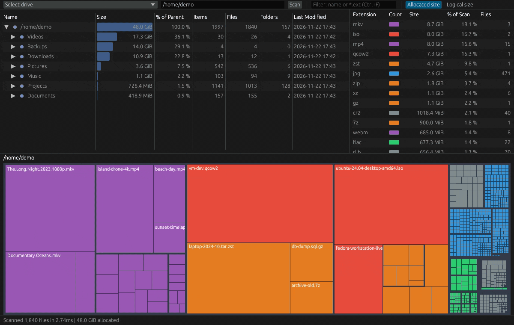

# inodetree

A fast, open-source disk space analyzer for Linux, written in Rust, with a community port to
macOS. It is inspired by WizTree and is not affiliated with it.

inodetree scans a directory tree with a parallel walker (`getdents64` + `statx` on Linux,
`readdir` + `fstatat` on macOS), keeps the
result in a compact arena, and shows it in a native GUI with three views of the same data:
a size-sorted directory tree, a per-extension breakdown, and an interactive treemap.



## Features

- Multi-threaded scan that stays on one filesystem and counts hard links once, so totals
  match `du`.
- Directory tree table with size bars, percent of parent, item counts and modification time.
- File extension table with a color legend. Click an extension to highlight its files.
- Squarified treemap with nested folders, name labels, hover tooltips, click-to-select
  (the tree scrolls to the item), double-click zoom and a clickable breadcrumb.
- Search box (`Ctrl+F`): plain text matches part of a name, `*` and `?` make a glob such as
  `*.iso`.
- Move to Trash (Freedesktop Trash on Linux, the Finder Trash on macOS) or delete permanently, from the context menu or the
  keyboard. The scan results update instantly, without rescanning.
- Allocated size (disk usage) or logical size (file length), switchable at any time.
- A `--headless` mode that prints a text report, useful for scripts and benchmarks.

## Install

Pre-built packages are attached to each
[GitHub release](https://github.com/Juanmidev1/inodetree/releases). They are built on
AlmaLinux 9, so they need glibc 2.34 or newer: RHEL, Rocky and Alma 9 or later, current
Fedora, and current openSUSE. RHEL 8 is not supported.

The packages are not signed.

### Fedora, RHEL, Rocky, AlmaLinux

Replace `0.1.0` with the version you downloaded.

```sh
sudo dnf install ./inodetree-0.1.0-1.x86_64.rpm
```

### openSUSE

```sh
sudo zypper --no-gpg-checks install ./inodetree-0.1.0-1.x86_64.rpm
```

Use the `aarch64` file on ARM machines. Each release also lists `SHA256SUMS`.

### Other distributions (tarball)

Replace `0.1.0` with the version you downloaded.

```sh
tar xzf inodetree-0.1.0-linux-x86_64.tar.gz
sudo install -Dm755 inodetree-0.1.0-linux-x86_64/inodetree /usr/local/bin/inodetree
sudo install -Dm644 inodetree-0.1.0-linux-x86_64/assets/inodetree.desktop \
    /usr/local/share/applications/inodetree.desktop
sudo install -Dm644 inodetree-0.1.0-linux-x86_64/assets/inodetree.svg \
    /usr/local/share/icons/hicolor/scalable/apps/inodetree.svg
```

### macOS (community port, not officially supported)

The macOS port was written by a contributor who wanted to share it with the project
([#1](https://github.com/Juanmidev1/inodetree/pull/1)). It is not officially supported: the
maintainer does not use macOS, so the port is only checked by the automated build and tests in
CI. macOS users are welcome to maintain it, and issues and pull requests that improve it are
appreciated.

There are no pre-built macOS packages. Build from source (below). Some things work differently
on macOS:

- Scanning folders such as `~/Library` needs Full Disk Access for the terminal or app that runs
  inodetree.
- To scan everything you own, scan `/System/Volumes/Data` rather than `/`, because `/` is the
  read-only system volume.
- APFS clones (for example, files duplicated in Finder) share their blocks on disk but are
  counted in full, so totals can be larger than what Finder shows. `du` counts them the same way.
- Move to Trash asks Finder to do it, so the first time macOS may ask you to let inodetree (or
  your terminal) control Finder. If you deny it, the move fails and nothing is deleted.

### From source

You need Rust 1.85 or newer and a C linker. On macOS, the linker comes with the Xcode Command
Line Tools (`xcode-select --install`). No `-devel` packages are required.

```sh
git clone https://github.com/Juanmidev1/inodetree.git
cd inodetree
cargo build --release
./target/release/inodetree
```

## Runtime requirements (Linux)

The GUI needs an OpenGL stack and a keyboard library, which every desktop distribution
already ships: `libEGL.so.1` and `libxkbcommon.so.0` (the RPM requires both). It runs on
Wayland and on X11.

## Usage

```sh
inodetree                    # open the GUI, pick a drive or type a path, press Scan
inodetree /home              # open the GUI and scan /home right away
inodetree --headless /var    # print a text report instead of opening a window
inodetree --headless /var --top 20 --logical
```

| Key | Action |
| --- | --- |
| `Ctrl+F` | Focus the search box (`Esc` clears it) |
| `F5` | Rescan |
| `Delete` | Move the selected item to the Trash |
| `Shift+Delete` | Delete the selected item permanently (asks for confirmation) |
| `Ctrl+C` | Copy the selected item's full path |

On macOS, use `Cmd` instead of `Ctrl`. On Mac laptops, `Delete` in the table is forward delete,
so press `Fn+Delete` (or `Fn+Shift+Delete`), and `F5` may also need `Fn`.

Right-click a row in the tree or a block in the treemap for the same context menu.
The scan root and mount points inside the scan cannot be deleted from the app.

Without root, directories you cannot read are skipped and counted in the status bar, so a
scan of `/` reports less than `df`. Run it with the privileges you need for the folder you
want to analyze.

## Troubleshooting (Linux)

- **The window does not open and the terminal mentions EGL, GL or xkbcommon:** install the
  missing libraries. On Fedora and RHEL: `sudo dnf install libglvnd-egl libxkbcommon`.
  On openSUSE: `sudo zypper install libglvnd libxkbcommon0`.
- **X11 sessions** also use `libX11`, `libXcursor`, `libXi` and `libXrender`, and Wayland
  sessions use `libwayland-client` and `libwayland-egl`. A normal desktop install has them.

## Development

```sh
cargo fmt --check
cargo clippy --all-targets -- -D warnings
cargo test
```

The scan engine, arena, filter and treemap layout have no GUI dependency, so the tests run
without a display server. To build the RPM locally:

```sh
cargo install cargo-generate-rpm
cargo build --release
cargo generate-rpm
```

Releases are built by GitHub Actions when a tag such as `v0.1.0` is pushed. The tag must
match the version in `Cargo.toml`.

## License

MIT, see [LICENSE](LICENSE).
